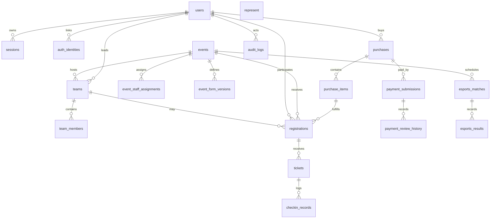

# PostgreSQL Database Schema Reference

This is a target design reference for the new system, not a dump of the legacy SQLite schema. Implement it with Drizzle ORM and PostgreSQL migrations. Names may be adapted to normal SQL conventions, but preserve the entities, relationships, and invariants. Use UUIDs for internal primary keys unless an external human-facing identifier is explicitly required. Use `timestamptz` in UTC. Money is integer paise (`bigint` or safe integer `integer` with bounds), never floating point.

## 1. Enum/reference values

- `user_role`: `PARTICIPANT`, `VOLUNTEER`, `EVENT_LEAD`, `SUPER_ADMIN`
- `event_category`: `TECHNICAL`, `CULTURAL`, `E_SPORTS`, `SPORTS`, `MANAGEMENT`, `LITERARY`, `WORKSHOP`, `INTERACTIVE`, `RECREATIONAL`, `SHOWCASE`, `OTHER`
- `event_status`: `DRAFT`, `OPEN`, `CLOSED`, `COMPLETED`, `CANCELLED`
- `event_format`: `INDIVIDUAL`, `TEAM`, `EITHER`
- `price_model`: `FREE`, `PER_PARTICIPANT`, `PER_TEAM`
- `capacity_unit`: `SEATS`, `TEAMS`, `ENTRIES`
- `team_status`: `DRAFT`, `READY`, `LOCKED`, `CANCELLED`
- `team_member_status`: `INVITED`, `ACCEPTED`, `DECLINED`, `REMOVED`
- `purchase_status`: `AWAITING_PAYMENT`, `PENDING_VERIFICATION`, `PAID`, `CANCELLED`, `EXPIRED`, `FULFILLMENT_FAILED`
- `payment_status`: `SUBMITTED`, `ON_HOLD`, `APPROVED`, `REJECTED`, `WITHDRAWN`
- `registration_status`: `RESERVED`, `CONFIRMED`, `CANCELLED`, `EXPIRED`
- `ticket_status`: `ACTIVE`, `REVOKED`, `USED`, `VOID`
- `fulfillment_status`: `PENDING`, `COMPLETE`, `RETRY_REQUIRED`, `FAILED`
- `score_status`: `DRAFT`, `FINALIZED`
- `checkin_outcome`: `ACCEPTED`, `ALREADY_USED`, `INVALID`, `REVOKED`, `WRONG_EVENT`, `NOT_YET_VALID`, `EVENT_CLOSED`

Avoid database enums if your migration strategy makes future enum changes painful; `text` plus check constraints is acceptable. Keep the allowed values in one shared validation module.

## 2. Entity relationship overview

## 3. Tables

### `users`
- `id uuid PK`
- `email citext UNIQUE NOT NULL` (normalize and verify before treating as an identity)
- `display_name text NOT NULL`
- `avatar_url text NULL`
- `phone text NULL`
- `institution_name text NULL`, `institution_id text NULL`, `is_student boolean NOT NULL DEFAULT false`
- `student_fields_locked boolean NOT NULL DEFAULT false`
- `role user_role NOT NULL DEFAULT 'PARTICIPANT'`
- `is_active boolean NOT NULL DEFAULT true`
- `email_verified_at timestamptz NULL`, `profile_completed_at timestamptz NULL`
- `created_at`, `updated_at timestamptz NOT NULL DEFAULT now()`
- Indexes: role, active status. Never accept a role from public registration payloads.

### `auth_credentials`
- `user_id uuid PK FK users ON DELETE CASCADE`
- `password_hash text NOT NULL`, `created_at`, `updated_at`
- Store only Argon2id hashes. Separate from users so OAuth-only accounts need no fake password.

### `auth_identities`
- `id uuid PK`, `user_id uuid FK users ON DELETE CASCADE`
- `provider text NOT NULL` (initially `google`), `provider_subject text NOT NULL`
- `provider_email text NULL`, `created_at timestamptz NOT NULL`
- `UNIQUE(provider, provider_subject)`; index user_id.
- Do not link identities by email alone unless the email is verified and the linking flow proves control of the existing account or a secure recovery flow is completed.

### `sessions`
- `id uuid PK`, `user_id uuid FK users ON DELETE CASCADE`
- `token_hash text UNIQUE NOT NULL` (never store raw bearer/cookie token)
- `created_at`, `last_seen_at`, `expires_at timestamptz NOT NULL`, `revoked_at timestamptz NULL`
- `ip_hash text NULL`, `user_agent text NULL`
- Index `(user_id, revoked_at)`, `expires_at`.
- Participant session: sliding expiry up to 30 days; staff/admin session hard maximum 12 hours. Rotation/revocation on login/security changes.

### `password_reset_tokens` and `email_verification_tokens`
- `id uuid PK`, `user_id uuid FK`, `token_hash text UNIQUE`, `expires_at`, `used_at`, `created_at`.
- One-time use, hashed at rest, short expiry, rate-limited issuance. Tokens never appear in logs.

### `festival_settings`
- `key text PK`, `value jsonb NOT NULL`, `updated_by uuid FK users`, `updated_at timestamptz NOT NULL`.
- Keep public configuration separate from secrets. Secrets belong in environment/secret manager, never this table.

### `festival_days`
- `day_number smallint PK CHECK (day_number BETWEEN 1 AND 3)`
- `date date UNIQUE NOT NULL`, `starts_at timestamptz NOT NULL`, `ends_at timestamptz NOT NULL`, `description text NULL`
- `CHECK (starts_at < ends_at)`.

### `events`
- `id uuid PK`, `slug text UNIQUE NOT NULL`, `title text NOT NULL`, `category event_category NOT NULL`, `format event_format NOT NULL`
- Public content: `short_description text NULL`, `description text NULL`, `rules text NULL`, `venue text NULL`, `organizer text NULL`, `eligibility text NULL`, `timeline jsonb NOT NULL DEFAULT '[]'`, `prizes jsonb NOT NULL DEFAULT '[]'`, `metadata jsonb NOT NULL DEFAULT '{}'`
- Schedule: `festival_day smallint FK festival_days`, `starts_at timestamptz NULL`, `ends_at timestamptz NULL`, `registration_opens_at timestamptz NULL`, `registration_closes_at timestamptz NULL`
- Lifecycle: `status event_status NOT NULL DEFAULT 'DRAFT'`
- Pricing: `price_model price_model NOT NULL DEFAULT 'FREE'`, `price_paise bigint NOT NULL DEFAULT 0 CHECK (price_paise >= 0)`, `student_price_paise bigint NULL CHECK (student_price_paise IS NULL OR student_price_paise >= 0)`
- Capacity: `capacity integer NULL CHECK (capacity IS NULL OR capacity > 0)`, `capacity_unit capacity_unit NOT NULL DEFAULT 'SEATS'`; use a separate reservation ledger/counter or a transactionally maintained counter. `NULL` means unlimited.
- Team: `min_team_size integer NOT NULL DEFAULT 1`, `max_team_size integer NOT NULL DEFAULT 1`, check `min >= 1 AND max >= min`.
- Scoring: `scoring_enabled boolean NOT NULL DEFAULT false`, `scoring_status text NOT NULL DEFAULT 'NOT_APPLICABLE'`, `max_rounds integer NOT NULL DEFAULT 1 CHECK (max_rounds >= 1)`, `volunteers_can_score boolean NOT NULL DEFAULT false`, `leaderboard_public boolean NOT NULL DEFAULT false`.
- `created_by uuid FK users`, `created_at`, `updated_at`, `deleted_at timestamptz NULL` (prefer lifecycle status to destructive deletion after purchases exist).
- Check: if category is not `E_SPORTS`, scoring must be disabled and public leaderboard off.
- Indexes: `(status, festival_day)`, category, starts_at, lower(title) if search needs it.
- Only admins may change price/capacity/category/team constraints. Assigned event leads may change descriptive/public fields only.

### `event_form_versions`
- `id uuid PK`, `event_id uuid FK events ON DELETE CASCADE`, `version integer NOT NULL`, `schema jsonb NOT NULL`, `published_at timestamptz NULL`, `created_by uuid FK users`, `created_at timestamptz NOT NULL`
- `UNIQUE(event_id, version)`. Validate schema structure on write and responses against the exact published version. Do not mutate an existing version; create a new one.

### `event_staff_assignments`
- `event_id uuid FK events ON DELETE CASCADE`, `user_id uuid FK users ON DELETE CASCADE`, `role` constrained to `EVENT_LEAD` or `VOLUNTEER`, `assigned_by uuid FK users`, `assigned_at timestamptz NOT NULL`, `revoked_at timestamptz NULL`
- Composite PK `(event_id, user_id)` or use ID plus unique active assignment. Enforce one active assignment per event/user. Staff access is derived from active assignment plus global role; never trust client event IDs without checking assignment.

### `teams`
- `id uuid PK`, `event_id uuid FK events`, `name text NOT NULL`, `leader_user_id uuid FK users`, `status team_status NOT NULL DEFAULT 'DRAFT'`, `locked_at timestamptz NULL`, `created_at`, `updated_at`
- Unique active team name per event (case-insensitive partial unique index); unique active team leader per event if product rules allow one team per leader/event.
- A team is scoped to one event. Do not use one team across unrelated events.

### `team_members`
- `id uuid PK`, `team_id uuid FK teams ON DELETE CASCADE`, `user_id uuid FK users NULL`, `invited_email citext NOT NULL`, `display_name text NULL`, `role text NOT NULL DEFAULT 'MEMBER'` (`LEADER`/`MEMBER`), `status team_member_status NOT NULL DEFAULT 'INVITED'`, `invited_at`, `responded_at`, `created_at`
- Partial unique indexes prevent duplicate active invite email and duplicate active user in the same team. Enforce leader/member invariants in transaction/service and, where possible, constraints.
- Team leader must correspond to an accepted member or be represented consistently by a separate leader relationship; choose one canonical representation and test it.

### `purchases`
- `id uuid PK`, `public_id text UNIQUE NOT NULL` (human-safe order reference), `buyer_id uuid FK users`, `status purchase_status NOT NULL`, `currency char(3) NOT NULL DEFAULT 'INR'`, `subtotal_paise bigint NOT NULL CHECK >= 0`, `total_amount_paise bigint NOT NULL CHECK >= 0`, `payment_method text NULL` (`UPI`/`FREE`), `reservation_expires_at timestamptz NULL`, `cancelled_at`, `paid_at`, `created_at`, `updated_at`
- `fulfillment_status fulfillment_status NOT NULL DEFAULT 'PENDING'`, `fulfillment_error_code text NULL`, `fulfillment_attempts integer NOT NULL DEFAULT 0`.
- Check totals are nonnegative; server calculates totals from current database pricing. Never accept client prices/amounts.
- Index buyer/date, status/date, reservation expiry.

### `purchase_items`
- `id uuid PK`, `purchase_id uuid FK purchases ON DELETE CASCADE`, `event_id uuid FK events`, `team_id uuid FK teams NULL`, `participant_user_id uuid FK users NULL`, `quantity integer NOT NULL DEFAULT 1 CHECK (quantity > 0)`, `unit_price_paise bigint NOT NULL CHECK >= 0`, `line_total_paise bigint NOT NULL CHECK >= 0`, `description_snapshot jsonb NOT NULL`, `created_at`
- Snapshot event title, price model, and relevant purchase-time details to preserve order history. `team_id` vs `participant_user_id` must match event format. If one line represents a team, ticket/registration creation still creates one registration/ticket per intended attendee.

### `registrations`
- `id uuid PK`, `event_id uuid FK events`, `purchase_item_id uuid FK purchase_items`, `participant_user_id uuid FK users`, `team_id uuid FK teams NULL`, `status registration_status NOT NULL`, `seat_count integer NOT NULL DEFAULT 1 CHECK (seat_count > 0)`, `form_version_id uuid FK event_form_versions NULL`, `form_response jsonb NOT NULL DEFAULT '{}'`, `confirmed_at`, `cancelled_at`, `created_at`, `updated_at`
- Unique constraints prevent duplicate active registration for same event+participant and duplicate active registration for same event+team where applicable. Implement partial unique indexes for active statuses if needed.
- For a team entry, create participant-scoped registrations for every roster member who is supposed to attend; do not treat leader as the only attendee. Preserve which team/purchase item the registration belongs to.
- Keep form response scope explicit. Participant answers belong to participant registration. Team-wide answers, if supported, belong in a separate `team_form_responses` table with schema version and team ID.

### `payment_submissions`
- `id uuid PK`, `purchase_id uuid FK purchases`, `submitted_by uuid FK users`, `status payment_status NOT NULL DEFAULT 'SUBMITTED'`, `utr_normalized text NOT NULL`, `evidence_object_key text NULL`, `evidence_mime_type text NULL`, `evidence_size_bytes integer NULL`, `submitted_amount_paise bigint NULL CHECK >= 0`, `submitted_at timestamptz NOT NULL`, `updated_at timestamptz NOT NULL`
- A purchase may have multiple historical submissions, but only one active submission (`SUBMITTED` or `ON_HOLD`) at a time via partial unique index. Enforce normalized UTR uniqueness across active/submitted/approved records; define duplicate policy in decisions. Do not store public evidence URLs.
- Only Super Admin can retrieve evidence metadata/object and review details. Participant can see own submission status. Leads/volunteers receive only sanitized purchase status.

### `payment_review_history`
- `id uuid PK`, `payment_submission_id uuid FK payment_submissions`, `reviewer_user_id uuid FK users`, `decision text CHECK IN ('APPROVED','REJECTED','ON_HOLD')`, `reason_code text NULL`, `note_private text NULL`, `created_at timestamptz NOT NULL`, `request_id text NULL`
- Append-only. Application role should not update/delete history. Notes are private to admins and never returned to event staff.

### `tickets`
- `id uuid PK`, `public_id text UNIQUE NOT NULL`, `registration_id uuid UNIQUE FK registrations`, `purchase_id uuid FK purchases`, `event_id uuid FK events`, `owner_user_id uuid FK users`, `status ticket_status NOT NULL DEFAULT 'ACTIVE'`, `qr_version integer NOT NULL DEFAULT 1`, `issued_at`, `revoked_at`, `used_at`, `created_at`, `updated_at`
- One ticket per attendee registration by default. QR contains only opaque ticket ID + version + signature, never personal data. HMAC secret stays outside DB. Revoke/rotate by incrementing version and changing state.

### `checkin_records`
- `id uuid PK`, `ticket_id uuid FK tickets`, `event_id uuid FK events`, `scanned_by_user_id uuid FK users`, `outcome checkin_outcome NOT NULL`, `request_id text NULL`, `device_id text NULL`, `scanned_at timestamptz NOT NULL`, `details jsonb NOT NULL DEFAULT '{}'`
- Append-only history. Use transaction/conditional update/row lock so concurrent scans cannot accept the same ticket twice. Store failed scan outcomes carefully; do not put QR secrets in details.

### `esports_matches`
- `id uuid PK`, `event_id uuid FK events`, `round_number integer NOT NULL CHECK > 0`, `match_number integer NOT NULL CHECK > 0`, `participant_a_registration_id uuid FK registrations NULL`, `participant_b_registration_id uuid FK registrations NULL`, `scheduled_at timestamptz NULL`, `status text NOT NULL` (`SCHEDULED`, `IN_PROGRESS`, `COMPLETED`, `VOID`), `created_by uuid FK users`, `created_at`, `updated_at`
- `UNIQUE(event_id, round_number, match_number)`. Ensure event category is E_SPORTS at service boundary.

### `esports_results` and `esports_result_history`
- Current result: `id uuid PK`, `match_id uuid UNIQUE FK esports_matches`, `winner_registration_id uuid FK registrations NULL`, `score_a numeric(10,2) NULL`, `score_b numeric(10,2) NULL`, `notes text NULL`, `recorded_by uuid FK users`, `finalized_at timestamptz NULL`, `updated_at timestamptz`.
- History: `id uuid PK`, `match_id uuid FK esports_matches`, `changed_by uuid FK users`, `before_state jsonb NULL`, `after_state jsonb NOT NULL`, `reason text NOT NULL`, `created_at timestamptz NOT NULL`.
- Finalization and corrections require explicit permissions and audit history. Tie-breaking is documented in `docs/DECISIONS.md`.

### `audit_logs`
- `id uuid PK`, `actor_user_id uuid FK users NULL`, `action text NOT NULL`, `target_type text NOT NULL`, `target_id text NULL`, `request_id text NULL`, `ip_hash text NULL`, `before_state jsonb NULL`, `after_state jsonb NULL`, `created_at timestamptz NOT NULL`
- Append-only. Exclude passwords, raw tokens, QR HMACs, full UTRs, and evidence bytes. Use allowlisted fields in before/after snapshots.

### Optional but recommended supporting tables
- `idempotency_keys`: `(scope, key)` unique, request hash, stored status/response, expiry. Required for purchase creation/payment decision retry semantics.
- `outbox_jobs`: durable async fulfillment/notification jobs with status, attempts, next retry, payload, timestamps. Do not rely on in-memory timers for critical fulfillment.
- `team_form_responses`: `team_id`, `form_version_id`, `response jsonb`, submitter, timestamps, if team-level forms are needed.

## 4. Critical constraints and indexes
1. Email is unique case-insensitively (`citext` or normalized lowercase column).
2. UTR is normalized before duplicate detection; define whether rejected UTRs can be reused. Approved UTRs must never be reused.
3. Only one active reservation for the same participant/event or team/event.
4. Only one active payment submission per purchase.
5. Only one ticket per attendee registration.
6. Only one successful check-in per ticket.
7. Event capacity must not be exceeded under concurrency; counters are not authoritative unless maintained transactionally.
8. A ticket may only be issued for a confirmed registration on a paid/free-complete purchase.
9. Staff assignment rows must be active to authorize event access.
10. Payment review history, audit logs, check-in records, and result history are append-only at application level.

## 5. Capacity strategy
Use PostgreSQL transactions. For each affected event, lock its event row (`SELECT ... FOR UPDATE`) in deterministic event-ID order before counting/creating active reservations, or use a conditional counter update with a database check. Keep reservation rows and capacity changes in the same transaction. For multi-event purchases, lock all relevant event rows in sorted order to reduce deadlocks. Release reservation exactly once on cancel/expiry. Tests must run concurrent transactions and prove capacity cannot be exceeded.

## 6. Migration requirements
- Use Drizzle migrations checked into source control; never rely on `drizzle-kit push` in production.
- Add foreign keys and indexes in migrations; seed data is separate from schema migration.
- Use a repeatable seed/import script with a dry-run option and a clear report.
- Prefer status transitions and soft deletion over destructive deletes for paid registrations, payments, tickets, and events with history.
